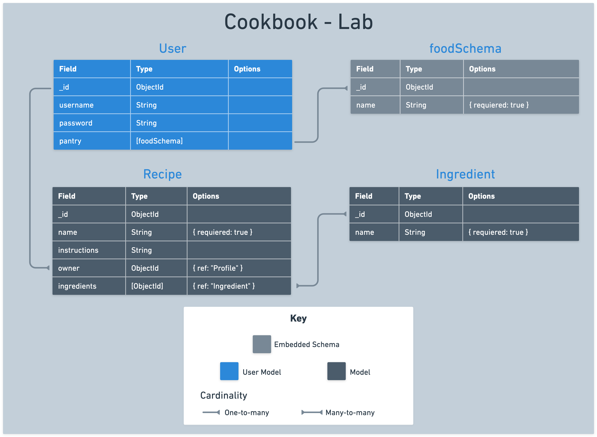

# 

## Introduction

In this lab you'll create the CookBook app, a dynamic pantry manager tailored for cooking enthusiasts! This app is all about organization and inspiration. You'll be practicing using embedded data schemas within a user model, crafting a smooth navigation experience, and fostering a community of other aspiring chefs. Users will have the power to perform full CRUD operations and manage their pantry items with ease. They'll also have the opportunity to explore other users' pantries, drawing inspiration and sharing their love for cooking.

**MVP: Your task is to perform full crud on food items in a users `pantry` - an embedded data schema on the `user` model.**

## User stories and application planning

Use the following user stories to guide the functionality and features of your application:

  - As a User (AAU), I want to sign up for an account and sign in, so that I can access my personal user profile and manage my pantry.
  - AAU, I want an easy and consistent way to navigate through the site, whether I am signed in or not. I need to quickly access options to sign up, sign in, view my pantry, or sign out, depending on my current status.
  - AAU, I need a dedicated page to view all items in my pantry, to easily manage and review what I have stored.
  - AAU, I want to easily find and click on an 'Add New Item' link, which takes me to a form for adding new items to my pantry
  - AAU, after filling out the pantry item form, I want to submit it and receive confirmation that the item has been saved in my pantry.
  - AAU, I need the ability to edit and delete items in my pantry, allowing me full control over managing my stored items.
  - AAU, I am interested in viewing a list of all other app users, to foster a sense of community and interaction within the app.
  - AAU, I want the option to click on another user's profile and view all the items in their pantry, to exchange ideas or find inspiration for my own pantry.

## Data modeling and ERD

Your task is to create a `Pantry`, an embedded array within the `User` model. This array represents the user's collection of food items. Because the pantry holds foods, the name of our schema will be `foodSchema`.

An ERD will help visualize this relationship:



### Create food schema

Each user's pantry will contain an array of `foods`, each defined by a simple schema:

| Property        | Type     | Required  |
|-----------------|----------|-----------|
| name            | String   | true      |

Begin by defining `foodSchema` in the `user` model file using the `mongoose.Schema` method. Include the necessary properties for food items.

```js
// user.js

const foodSchema = new mongoose.Schema({
  // define properties of food schema
});
```

### Embed `foodSchema` in `userSchema` 

Next, modify `userSchema` to include the `foodSchema`. Do this by adding a property named `pantry`. This property will utilize the `foodSchema` to represent a list of food items associated with a user.

```js
const userSchema = new mongoose.Schema({
  username: {
    type: String,
    required: true,
  },
  password: {
    type: String,
    required: true,
  },
  pantry: // embed foodSchema here
});
```

## Define RESTful routes for managing data

Use this chart as a guide when building your RESTful routes.

| Action   | Route                                     | HTTP Verb  |
|----------|-------------------------------------------|------------|
| Index    | '/users/:userId/foods'                    | GET        |
| New      | '/users/:userId/foods/new'                | GET        |
| Create   | '/users/:userId/foods'                    | POST       |
| Show     | '/users/:userId/foods/:itemId'            | GET        |
| Edit     | '/users/:userId/foods/:itemId/edit'       | GET        |
| Update   | '/users/:userId/foods/:itemId'            | PUT        |
| Delete   | '/users/:userId/foods/:itemId'            | DELETE     |

Because this data is embedded in the user model, our routes need to be structured to reflect that relationship.

## Structure and Setup

### Build the controller

- Create a file called `foods.js` in the controllers directory.
- Require all essential modules at the top of `foods.js`
- Export your router for use in `server.js`

```js
// controllers/foods.js

const express = require('express');
const router = express.Router();

const User = require('../models/user.js');

// todo: build your router logic here

module.exports = router;
```

### Use the controller in server

- Import the foods controller in `server.js`.
- Use middleware to direct incoming requests to `/users/:userId/foods` to the foods controller.


```js
// server.js

const authController = require('./controllers/auth.js');
const foodsController = require('./controllers/foods.js');
```

```js
// server.js

app.use('/auth', authController);
app.use('/users/:userId/foods',foodsController);
```

## Add middleware

Now you'll need to add two middleware functions to your application:

- one that restricts access to logged-in users only
- one that makes the user object available to view templates via `res.locals`. 

Create a `middleware` folder in your project root. Inside this folder:

Create a file named `is-signed-in.js`.

- This function should include logic that checks if `req.session.user` exists, and if it does, allows the request to continue on the normal chain by invoking `next()`
- If a user session does not exist, the user should be redirected to the sign in page.

```js
// middleware/is-signed-in.js

const isSignedIn = (req, res, next) => {
  if (req.session.user) return next();
  res.redirect('/auth/sign-in');
};

module.exports = isSignedIn;
```

Create a file named `pass-user-to-view.js`.

- This function should include logic that assigns `req.session.user` to `res.locals.user` (available in our views). If no user is found, we set it to `null`. Then allow the request to continue on the normal chain by invoking `next()`.

```js
// middleware/pass-user-to-view.js

const passUserToView = (req, res, next) => {
  res.locals.user = req.session.user ? req.session.user : null
  next()
}

module.exports = passUserToView
```

Import and include both middleware functions above all of the routes and controllers in `server.js.`.

```js
// server.js
const isSignedIn = require('./middleware/is-signed-in.js');
const passUserToView = require('./middleware/pass-user-to-view.js');
```

These middleware functions should run before any routes that check for a valid user or require a user to be signed in to view a page. 

For this application, users must be signed in to view any of the routes associated with their pantry. Therefore, `isSignedIn` should come above the `foods` controller, but not before `auth`.

```js
app.use(passUserToView)
app.use('/auth', authController);
app.use(isSignedIn);
app.use('/users/:userId/foods',foodsController);
```

You are now ready to begin building your protected routes. 

## Build the `nav` partial

Implement the following user story:

> AAU, I want an easy and consistent way to navigate through the site, whether I am signed in or not. I need to quickly access options to sign up, sign in, view my pantry, or sign out, depending on my current status.

Currently the links for "Sign up" or "Sign in" are hardcoded onto the homepage. You will need to refactor and move these links into a nav bar partial for a better user experience.

- Create a directory called `partials` inside the `views` directory.
- Inside partials, create a new file called `_navbar.ejs`

Create a nav  inside `_navbar.ejs`:

- This nav should have a `home` link displayed on every page.
- Other links should be rendered conditionally based on whether or not a `user` is signed in.
- If a `user` is signed in, they should see links to "View my Pantry" or "Sign Out".
- If a `user` is not signed in, they should see links to "Sign In" or "Sign Up".

```html
<nav>
  <a href="/">Home</a>
  <% if(user) { %>
    <a href="/users/<%=user._id%>/foods">View my Pantry</a>
    <a href="/auth/sign-out">Sign Out</a>
  <% } else { %>
    <a href="/auth/sign-in">Sign In</a>
    <a href="/auth/sign-up">Sign Up</a>
  <% } %>
</nav>
```

For the best user experience, you'll want to include this nav partial at the top of all of your existing templates.

```html
<%- include('./partials/_navbar.ejs') %>
```

With the nav partial included, you can now replace the hardcoded links on your homepage with a partial and some simple welcome text. 

```html
<body>
  <%- include('./partials/_navbar.ejs') %>
  <h1>Welcome to CookBook</h1>
</body>
```

## Build the `index` route

With the main structure of the application complete, it's time to start building out the site pages guided by user stories.

### Conceptualize the `index` route

For your landing page, you will use:

   - `GET` `/users/:userId/foods`

### Define the `index` route

- In your `foods` controller, create a new `index` route to serve as the landing page. Test by visiting `localhost:3000/users/foods`.
- This route should `res.render()` a `index.ejs` view.

```js
router.get('/', (req, res) => {
  res.render('foods/index.ejs')
});
```

### Render the `index` template

- Create a new directory called `foods` inside of the `views` directory. This will hold the templates for your `foods` pages. 

- Create an `index.ejs` file in `foods`. Add a basic HTML boilerplate to this file.

```html
<!DOCTYPE html>
<html lang="en">
  <head>
    <meta charset="UTF-8">
    <meta name="viewport" content="width=device-width, initial-scale=1.0">
    <title>My Pantry</title>
  </head>
  <body>
    <h1>Welcome to my Pantry</h1>
  </body>
</html>
```

- Test your new route in the browser to confirm that everything renders correctly.


## Build the `new` page

Implement the following user story:

> AAU, I want to easily find and click on an 'Add New Item' link, which takes me to a form for adding new items to my pantry


### Conceptualize the `new` route

For your `new` page, you will use:

   - `GET` `/users/:userId/foods/new`

### Define the `new` route

This route will render a page that displays a form to add a new item to the user's pantry. 

- In `controllers/foods.js`, create a `new` route.
- This route should `res.render()` a `new.ejs` view.
- Add a "Add New Item" link to the `index` page and point it to your new route.

### Render the `new` template

- Create a new template called `new.ejs` in the `views` directory.
- This view should display a form to add a new food item to the user's pantry. Design your form based on the `foodschema` defined earlier.
- The form action will `POST` to the `create` route.

## Build the `create` functionality

Implement the following user story:

> AAU, after filling out the pantry item form, I want to submit it and receive confirmation that the item has been saved in my pantry.

### Conceptualize the `create` route

This route will:

- `POST` to `/users/:userId/foods`


### Define the `create` route

This route will create new `foods` in the embedded pantry array on the `user` model. 

- Look up the user from `req.session`
- Push `req.body` (the new form data object) to the `pantry` array of the current user.
- Save changes to the `user`.
- Redirect back to the application's `index` view.
- If any errors, log them and redirect back home `/`.

## Add pantry items to `index` page

Implement the following user story:

> AAU, I need a dedicated page to view all items in my pantry, to easily manage and review what I have stored.

### Build the `index` functionality

Refactor the `index` route to send all items in a user's pantry to the `index` view:

- Look up the current user's pantry
- Send all pantry items to the view via `res.locals`
- If any errors, log them and redirect back home `/`.

### Update the `index` template

- Use conditional rendering to display a list of pantry items or a message that reads "There are no items in this pantry."

## Build the `edit` and `delete` functionality

Implement the following user story:

> AAU, I need the ability to edit and delete items in my pantry, allowing me full control over managing my stored items.

### Conceptualize the `delete` route

This route will:

- `DELETE` to `/users/:userId/foods/:itemId`
- Add `?_method=DELETE` to utilize the method override middleware

### Define the `delete` route

- Define the `delete` route in the `foods` controller

### Add `delete` link to the `index` template

- Add a simple form element to each pantry item that posts to the `delete` route
- The form should appear as a single `delete` button in the UI

### Build the `delete` functionality

This route will delete the food item from the user's pantry.

- Look up the user from `req.session`
- Use the `.deleteOne()` method to delete a food using the id supplied from `req.params`
- Save changes to the `user`
- If any errors, log them and redirect back home `/`.

## Build the `edit` page

### Conceptualize the `edit` route

For your `edit` page, you will use:

- `GET` `/users/:userId/foods/:itemId/edit`

### Define the `edit` route

This route will render a page that displays a form to edit a specific food item in the user's pantry.

- In `controllers/foods.js`, create an `edit` route.
- This route should `res.render()` an `edit.ejs` view.
- For a better user experience, Find the current food from the id supplied by `req.params` and provide it to the user in the edit form.
- Add an edit link to each food item rendered on the index page.

### Render the `edit` template

- Create a new template called `edit.ejs` in the `views` directory.
- This view should display a form to edit a specific food item in the user's pantry. Design your form based on the `foodschema` defined earlier.
- Auto-fill the form with the `food` data supplied from the route.
- The form action will `POST` to the `update` route.

## Build the `update` functionality 

### Conceptualize the `update` route

This route will:

- `POST` to `/users/:userId/foods/:itemId`
- Add `?_method=PUT` to utilize the method override middleware

### Define the `update` route

- Define the update route in the `foods` controller

### Build the `update` functionality

This route will update a specific food item from the user's pantry:

- Find the user from `req.session`
- Find the current food from the id supplied by `req.params`
- Use the `.set()` method, updating the current food to reflect the new form data on `req.body`
- Save the current `user`
- Redirect back to the `index` view
- If any errors, log them and redirect back home `/`.

Now that you have full crud functionality, test each route end to end and check for errors before moving on. 

## Add a Community page

There are two final `user` views to reach your final application. Building a community page for users to find each other and gain inspiration from the pantry items of others.

Implement the following user story:

> AAU, I am interested in viewing a list of all other app users, to foster a sense of community and interaction within the app.

To meet this requirement you will need a new `users` controller and `views` directory for `users`. 

- Create a simple `/users` controller with an `index` route to get all users.
- Connect your new controller in `server.js`
- Create a new directory inside of `views` called `users`.
- Add a new view called `index.ejs`
- Render a list of all users on the `index` page.
- Add a link to your nav partial that says "Explore Our Community". Link it to your new community page.

## View other users' pantries

Implement the following user story:

> AAU, I want the option to click on another user's profile and view all the items in their pantry, to exchange ideas or find inspiration for my own pantry.

From the community page, users should be able to click on the names of other users and see their pantry. This requires one final route and view. 

- Create a `show` route in your `/users` controller
- Create a `show.ejs` in the `users` views directory
- Add a link for each user's `show` page in the rendered community list.
- On each user's `show` page, render a list of that user's pantry items.
- This list should be read-only.

Test your new community page. 

### Congrats! You have reached MVP! 🎉
