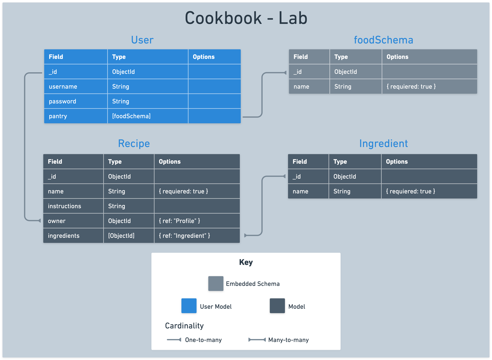

# 

## Introduction

In this lab you'll create the Cookbook app, a dynamic Cookbook tailored for cooking enthusiasts! In this lab, you'll be developing a web application that's all about managing recipes and their ingredients efficiently and creatively. You'll practice using referenced data schemas in MongoDB with `Recipe` and `Ingredient` models and cultivate a community of cooking enthusiasts. Users will have the capability to perform full CRUD operations on both recipes and ingredients, manage their recipe collections, and explore other users' recipes for inspiration.

**MVP: Your primary task is to implement full CRUD operations for Recipe and Ingredient models, using referencing to associate these entities.**

## User stories and application planning

Use the following user stories to guide the functionality and features of your application:

- As a User (AAU), I want to sign up for an account and sign in, so that I can access my personal user profile and manage my recipes.
- AAU, I want an easy and consistent way to navigate through the site, whether I am signed in or not. I need to quickly access options to sign up, sign in, view my recipes, or sign out, depending on my current status.
- AAU, I need a dedicated page to view all my recipes, to easily manage and review what I have created.
- AAU, I want to easily find and click on an 'Add New Recipe' link, which takes me to a form for adding new recipes to my collection.
- AAU, after filling out the recipe form, I want to submit it and receive confirmation that the recipe has been saved.
- AAU, I need the ability to edit and delete recipes in my collection, allowing me full control over managing my culinary creations.
- AAU, I want to be able to add new ingredients to my recipe manager. This way, I can keep track of the different ingredients I use across various recipes.
- AAU, when adding a new recipe, I want an option to quickly add ingredients that are not already in my list. This will streamline the process of recipe creation, ensuring I can include all necessary ingredients without navigating away from the recipe form.
- AAU, I am interested in viewing a list of all other app users, to foster a sense of community and interaction within the app.
- AAU, I want the option to click on another user's profile and view all the recipes they have created, to exchange ideas or find inspiration for my own collection.

## Data modeling and ERD

In this lab, your task is to create two primary models: `Recipe` and `Ingredient`. These models represent the core components of your Cookbook app. The `Recipe` model will reference the `Ingredient` model to create a comprehensive list of ingredients for each recipe. Here are the properties for each model:

### Create the `Recipe` schema

Create a new file in `models` called `recipe.js`. Create a mongoose schema with the following properties:

| Property     | Type                             | Required  | Description                                      |
|--------------|----------------------------------|-----------|--------------------------------------------------|
| name         | String                           | true      | The name of the recipe.                          |
| instructions | String                           | false     | The cooking instructions for the recipe.         |
| owner        | mongoose.Schema.Types.ObjectId   | true      | A reference to the `User` model.                 |
| ingredients  | [mongoose.Schema.Types.ObjectId] | false     | An array of references to the `Ingredient` model.|

### Create the `Ingredient` schema

Create a new file in `models` called `ingredient.js`. Create a mongoose schema with the following properties:

| Property     | Type     | Required  | Description                      |
|--------------|----------|-----------|----------------------------------|
| name         | String   | true      | The name of the ingredient.      |

### Referencing Data

In this lab, he `Recipe` model will reference the `Ingredient` model using an array of ObjectIds. Each recipe will be associated with a `User`, thereby creating a relationship between users and their collections of recipes and ingredients.

- You will be referencing the `Recipe` schema within the `User` schema, establishing a one-to-many relationship

- You will be referencing the `Ingredient` schema within the `Recipe` schema, establishing a many-to-many relationship

An ERD (Entity-Relationship Diagram) will help you visualize the relationships between these models:



In this diagram, you can see how each `Recipe` is connected to a `User` and how `Ingredients` are associated with `Recipes`. This structure forms the backbone of your Cookbook application, allowing users to manage their recipes and ingredients efficiently.

## Define RESTful routes for managing data

Use the following charts as guides when building your RESTful routes.


### Recipe routes

| Action | Route                                   | HTTP Verb |
|--------|-----------------------------------------|-----------|
| Index  | `/users/:userId/recipes`                | GET       |
| New    | `/users/:userId/recipes/new`            | GET       |
| Create | `/users/:userId/recipes`                | POST      |
| Show   | `/users/:userId/recipes/:recipeId`      | GET       |
| Edit   | `/users/:userId/recipes/:recipeId/edit` | GET       |
| Update | `/users/:userId/recipes/:recipeId`      | PUT       |
| Delete | `/users/:userId/recipes/:recipeId`      | DELETE    |


### Ingredient routes

| Action | Route                                                | HTTP Verb |
|--------|------------------------------------------------------|-----------|
| Index  | `/recipes/:recipeId/ingredients`                     | GET       |
| New    | `/recipes/:recipeId/ingredients/new`                 | GET       |
| Create | `/recipes/:recipeId/ingredients`                     | POST      |
| Edit   | `/recipes/:recipeId/ingredients/:ingredientId/edit` | GET       |
| Update | `/recipes/:recipeId/ingredients/:ingredientId`       | PUT       |
| Delete | `/recipes/:recipeId/ingredients/:ingredientId`       | DELETE    |

## Structure and Setup

### Build the Controllers

- Create files for the `recipes` and `ingredients` controllers in the controllers directory.
- Require all essential modules at the top of each controller file.
- Export your routers for use in `server.js`.

```javascript
// controllers/recipes.js

const express = require('express');
const router = express.Router();

const User = require('../models/user.js');
const Recipe = require('../models/recipe.js');

// todo: build your router logic here for recipes

module.exports = router;
```

Repeat this process for the `ingredients` controller. 

### Use the controllers in server

- Import the `recipes` and `ingredients` controllers in `server.js`.
- Use middleware to direct incoming requests to the respective controllers.


```js
// server.js

const authController = require('./controllers/auth.js');
const recipesController = require('./controllers/recipes.js');
const ingredientsController = require('./controllers/ingredients.js');
```

```js
// server.js

app.use('/auth', authController);
app.use('/users/:userId/recipes', recipesController);
app.use('/recipes/:recipeId/ingredients', ingredientsController);
```

## Add middleware

Now you'll need to add two middleware functions to your application:

- one that restricts access to logged-in users only
- one that makes the user object available to view templates via `res.locals`. 

Create a `middleware` folder in your project root. Inside this folder:

Create a file named `is-signed-in.js`.

- This function should include logic that checks if `req.session.user` exists, and if it does, allows the request to continue on the normal chain by invoking `next()`
- If a user session does not exist, the user should be redirected to the sign in page.

```js
// is-signed-in.js

const isSignedIn = (req, res, next) => {
  if (req.session.user) return next();
  res.redirect('/auth/sign-in');
};

module.exports = isSignedIn;
```

Create a file named `pass-user-to-view.js`.

- This function should include logic that assigns `req.session.user` to `res.locals.user` (available in our views). If no user is found, we set it to `null`. Then allow the request to continue on the normal chain by invoking `next()`.

```js
// middleware/pass-user-to-view.js

const passUserToView = (req, res, next) => {
  res.locals.user = req.session.user ? req.session.user : null
  next()
}

module.exports = passUserToView
```

Import and include both middleware functions above all of the routes and controllers in `server.js.`.

```js
// server.js
const isSignedIn = require('./middleware/is-signed-in.js');
const passUserToView = require('./middleware/pass-user-to-view.js');
```

These middleware functions should run before any routes that check for a valid user or require a user to be signed in to view a page. 

```js
// server.js

app.use(passUserToView);
app.use('/auth', authController);
app.use(isSignedIn);
app.use('/users/:userId/recipes', recipesController);
app.use('/recipes/:recipeId/ingredients', ingredientsController);
```

You are now ready to begin building your protected routes.